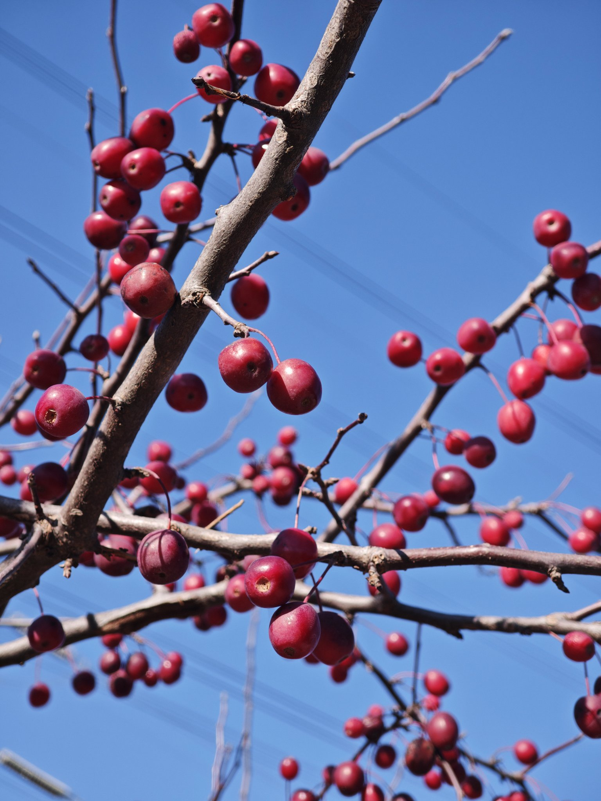
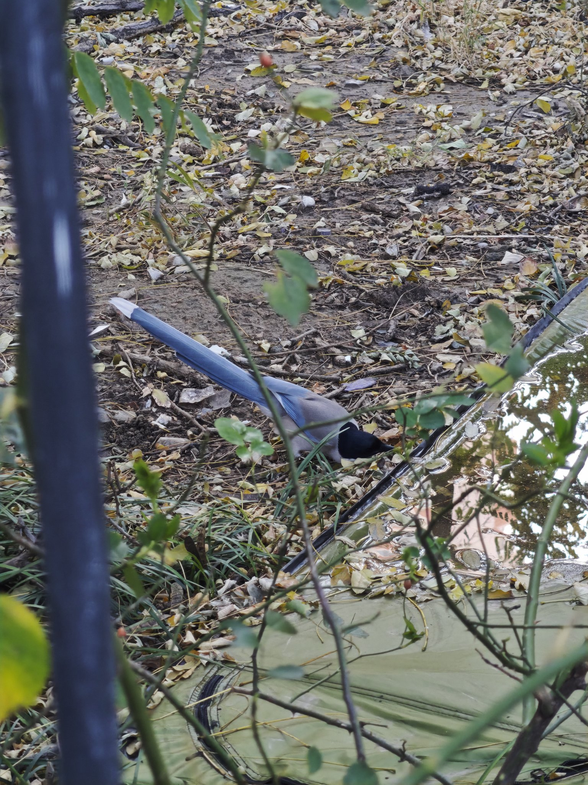

秋去，东来
10年前只身一人来到北京参加面试，那会还是大四学期。一边面临毕设论文编写，一边找工作，当时只面试了几家公司，有两家拿到offer，一个是星网锐捷，一个是我入职的中视广信。这是我人生的一个重要选择节点，如果去了锐捷，可能人生又是不一样过程。我选择了光鲜亮丽的央视网，在这里上班，仿佛站在了一个很高的平台，在这里我上了1年班，这是我人生第一次，也可能是唯一一次需要晚上值班的工作。在这里我初入职场，从一个学生走向工作岗位，学校教的和工作用到的确实不一样，学校大部分只会教你理论，教你这个公式那个定理，你需要记住公式，但是不知道应用在什么场景。刚开始工作中我很有干劲，我认为我的工作能力要强，我学到了很多学校没有教的。一年后，我拿到了毕业证书，我正式的成为一名打工人，因为这时候公司开始给我缴纳社保了。公司把我调整到其他岗位，我去了中央电视台，这里再一次的让我感觉自己深处庙堂之高，在这里的饭很好吃，我胖了许多，这里的工作很轻松。期间还会去北京电视台一段时间，这段时间更是工作很轻松。可能我的大脑已经麻痹了，享受着安于现状的快乐，2020年疫情以后，我感觉自己还是没多少钱，我要出去闯一闯。我面试了一个被人说是外包的公司，在邮储驻场，这里工资是我上家公司的2倍了。说实话，这里的工作内容也是对于我来说很简单，工作也是很轻松。后来我厌烦了当时的女领导，选择了离职。离职以后我入职了一家初创小公司，这里的氛围让我感到压抑，工作内容让我不舒服，我待了3个月再次选择离职，这时候我认识了老婆，我去了她在的城市深圳，这是我第一次去深圳。回来以后我找了现在的公司，当时我也是有两个offer选择，一个是传统的电信公司，一个就是现在这个互联网教育公司，我选择了后者。当时的我可能只是想看看这里的人是怎样工作的。没想到这里成为我上班时间最久的公司，2024年面临降薪，我选择了同意，再这个公司又待了2年，这两年待的很不舒服，我一直耗着，不干活，每天就是看看报，遛遛弯。这样的日子也快结束了。
2026年，在我来北京第10年，我的宝宝悄悄地来到我们的身边。
2027年，我就会迎接我的孩子的出生，又开始人生的新篇章，去乘风去破浪。