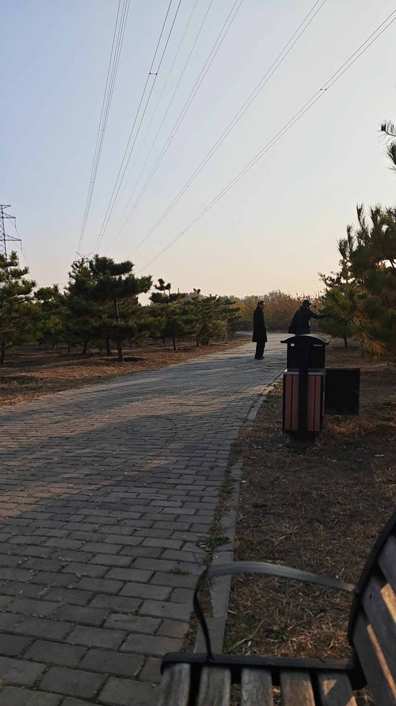

下午坐在公园长椅，打把游戏。不久一位老人坐在了的旁边，他开口先问，你们这打游戏花钱吗，我答，不花钱。
我游戏打完合上手机屏幕，他问我做什么工作的，我答，就是三旗百汇旁边的一个互联网教育培训公司。他说，看我年级应该有点阅历了，多少岁，我说31了。互联网之前多火，我说是，现在ai出现了。他说是太方便了，使用豆包比问医生都方便多了。我说是的，ai出现以后一个人月的工作，现在只需要1天，他说是啊，这国家的管这些，不然让底层老百姓去干嘛。后来又聊当年学潮就是因为贪污腐败的。又聊了汇率，中美地位，马斯克，聊制度，聊民主，老人说他快80了，我确实看不出，这个年纪还能紧跟时事，口齿清楚，难得。告别，祝您身体健康，长命百岁。